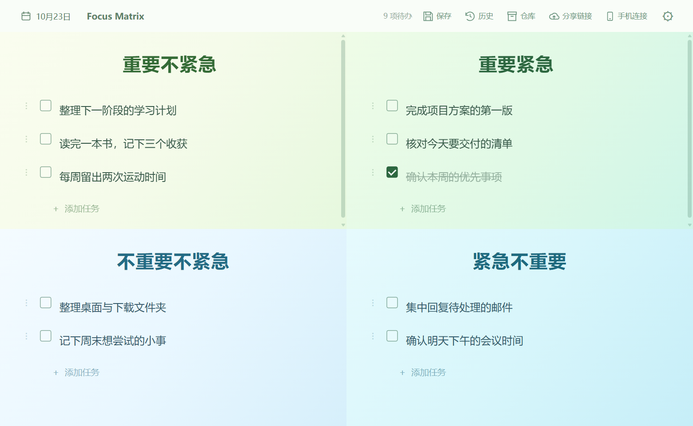
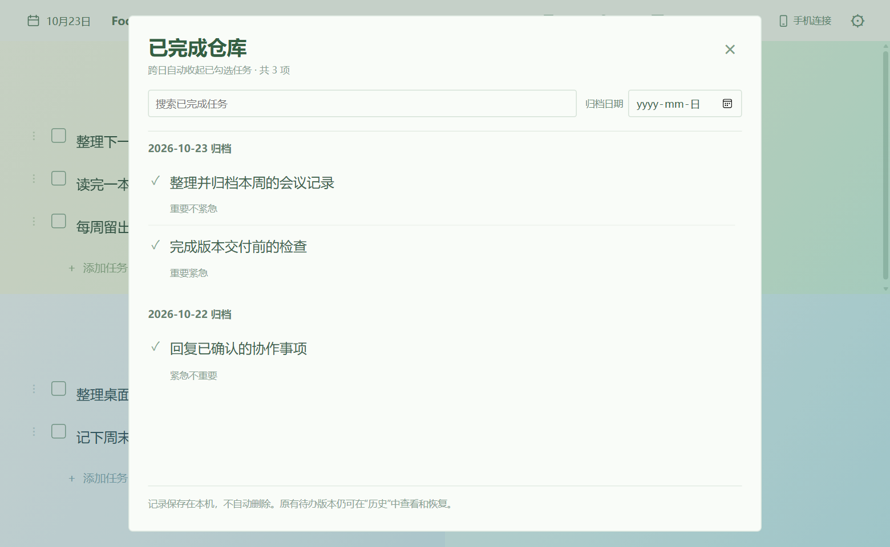

<div align="center">

# Focus Matrix

**把重要的事，留在眼前。**

Windows 桌面四象限任务便笺，配合每日备忘录、待办历史与已完成仓库。

[](https://github.com/keykonor/focus-matrix/actions/workflows/release-windows.yml)
[](https://github.com/keykonor/focus-matrix/releases)
[](LICENSE)

**[下载 Windows x64 安装包](https://github.com/keykonor/focus-matrix/releases/latest/download/FocusMatrix-Windows-x64-setup.exe)**

[使用指南](docs/usage.md) · [更新日志](CHANGELOG.md) · [开发文档](docs/development.md) · [源码与测试](https://github.com/keykonor/focus-matrix/actions/workflows/checks.yml) · [参与贡献](CONTRIBUTING.md)

Windows 10 / 11 · x64 · 本地功能离线可用

</div>



*截图来自当前源码的隔离浏览器预览，全部为示例内容，不含真实用户数据。*

## 让任务有轻重，让做过的事有记录

| 功能 | 用法 |
| --- | --- |
| **四象限任务** | 按重要与紧急分类，直接编辑、多行输入，拖动到其他象限。 |
| **每日备忘录** | 点开日期，分别记录早上、下午、晚上的安排。 |
| **已完成仓库** | 次日自动收起此前已完成的任务，保留完整内容，按日期和关键词查找。 |
| **待办历史** | 自动保留内容版本，也可手动保存；恢复待办前先保留当前版本。 |
| **桌面便笺** | 托盘常驻、置顶或桌面底层，调整透明度、字号和开机启动。 |
| **本地保存** | 任务、备忘录、仓库和设置离线使用；保存失败时保留原文件和恢复依据。 |

<details>
<summary><strong>看看每日备忘录与已完成仓库</strong></summary>

### 按日期记录安排


### 回看已完成的事



</details>

## 三步开始

1. 从 [Releases](https://github.com/keykonor/focus-matrix/releases) 下载 `FocusMatrix-Windows-x64-setup.exe`。
2. 如已安装旧版，先从托盘菜单选择 **退出**，再运行安装器。
3. 点击象限空白处或 **添加任务**，记下第一件事。Enter 新建下一项，Shift+Enter 换行。

安装器按当前用户安装；缺少 WebView2 时需要联网下载运行时。默认窗口 720 × 480，最小 520 × 360。
右上角 **× 默认隐藏到托盘**，真正退出请使用托盘菜单。

**安装包目前未签名。** 请从本仓库 Releases 下载，并核对同页 `SHA256SUMS.txt`；
源码 ZIP 不是安装包。[安装、校验及数据恢复说明](docs/usage.md#安装与校验)

## 更新时，已有内容继续保留

安装或卸载前会校验备份任务、日期备忘录、仓库、设置、窗口状态、历史及加密配置，备份失败就停止。
卸载保留应用数据；备份和内容历史不自动删除。

**恢复待办历史只替换待办列表**，保留当前日期备忘录、已完成仓库、设置及窗口位置。
不要用较早的整表快照覆盖后来新增的内容。[数据目录与恢复规则](docs/usage.md#数据与恢复)

## 云端与 Android 的支持范围

**公开版本优先提供 Windows 本地功能，云端不是开箱即用的公共服务。**
仓库保留同步、分享网页、CloudBase API 和 Android WebView 源码，但不包含维护者的写入凭据或签名密钥。
开源发布不代表原云服务、分享网页或 Android 真机同步已恢复。[详细范围与自建注意事项](docs/usage.md#云端分享与-android)

## 开发与贡献

桌面使用 **Tauri 2 + React 19 + TypeScript**。前端检查需要 Node.js 24；完整原生开发还需要 Windows、Rust MSVC、C++ Build Tools、Windows SDK 与 WebView2。

```powershell
npm ci
npm run release:check
npm test
npm run build
```

每个分支的提交和每个 PR 都配置源码与测试检查；Windows 流程另外验证原生持久化、跨日归档和安装升级的数据保留。
**没有每周扫描或定时维护任务。** 配置与实际运行结果见 [Actions](https://github.com/keykonor/focus-matrix/actions)，详细约定见 [维护机制](docs/MAINTENANCE.md)。

[开发与正式构建](docs/development.md) · [贡献指南](CONTRIBUTING.md) · [技术审计记录](docs/security/technical-review-20261023.md) · [历史版本清单](docs/version-history.md)

## 反馈与许可

普通问题请在 [Issues](https://github.com/keykonor/focus-matrix/issues) 提供版本、环境和合成数据复现步骤。
**不要公开上传任务文件、内容历史、分享/配对链接或密钥。** 安全问题请先阅读 [SECURITY.md](SECURITY.md)。

原始源码采用 [MIT](LICENSE)，第三方组件沿用各自许可证，见 [第三方声明](THIRD_PARTY_NOTICES.md)。
